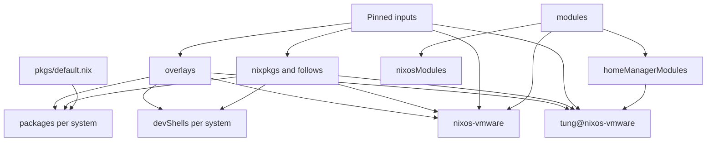

# Flake Outputs and Entry Points

`flake.nix` is the assembly point for this repository. Its inputs describe the external sources, while its outputs expose the repository's packages, overlays, reusable modules, development environments, and configuration entrypoints. `flake.lock` records the resolved input graph and revisions used by evaluation; changing an input declaration is not the same as updating the lock file.

## Inspected output graph



This shows construction and reuse, not a runtime boot sequence: the system and Home Manager outputs explicitly select modules and overlays, while packages and shells are independently addressable outputs.

## Inputs and evaluation boundaries

The flake declares the main `nixpkgs` channel, `nixpkgs-unstable`, a separate `nixpkgs-2511` for the retained `mysql80` package, Home Manager, Nixvim, `nix-phps`, Agenix, `nix-index-database`, and Herdr. Home Manager, `phps`, and `nix-index-database` follow the flake's main `nixpkgs` where declared. The lock graph also contains transitive inputs and their locked revisions, so evaluation is reproducible only when the lock file is available and respected.

The `systems` list is the portability boundary for `packages`, `formatter`, and `devShells`: `aarch64-linux`, `x86_64-linux`, `aarch64-darwin`, and `x86_64-darwin` are generated through `forAllSystems`. The NixOS and Home Manager configurations are different: the machine is constructed as the repository's NixOS system, while the standalone Home Manager output is explicitly fixed to `x86_64-linux`.

## Packages and overlays

### Packages

`packages` imports `pkgs/default.nix` with `nixpkgs.legacyPackages.${system}` and removes `phpLib` from the public package set. The public package outputs currently include `maven363` and `obsidian`; they can be built with commands such as:

```console
nix build .#maven363
nix build .#obsidian
```

`phpLib` is intentionally not a standalone flake package: it is a function that needs PHP configuration and a package set. It remains available through the `additions` overlay and is used by the shared PHP module and PHP-oriented shell/configuration code.

### Overlay composition

`overlays/default.nix` exports five overlays:

- `additions` imports the custom package set into `pkgs` and adds `herdrAgentFiles`, built from `inputs.herdr.outPath`.
- `modifications` aliases Docker to `docker_29`, enables OpenSSL support in `libzip`, and rebuilds the PHP 8.1, 8.2, and 8.3 definitions with static zlib and the required zip settings.
- `unstable-packages` exposes a separate `pkgs.unstable` set from `nixpkgs-unstable`, including the repository's Postman override.
- `mysql80-packages` imports `mysql80` from the pinned `nixpkgs-2511` input. It exists for the local stack because newer nixpkgs no longer carries that package.
- `phps` is the overlay exported by the `nix-phps` input and supplies versioned PHP packages such as `pkgs.php81`, `pkgs.php82`, and `pkgs.php83`.

An overlay is only effective in a package set where it is applied. The NixOS configuration applies all five overlays, the dev shells apply the additions, modifications, unstable, and PHP overlays, and the Home Manager configuration applies those four Home Manager overlays plus Herdr's external overlay. This is why a package visible in one output should not automatically be assumed visible in another.

## Reusable modules and shared PHP configuration

The module indexes export `php-config` from `modules/shared/php-config.nix`; the Home Manager index also exports `ngrok`. The shared PHP module defines typed `phpConfig.common`, `phpConfig.fpm`, `phpConfig.cli`, and per-version options, then computes a read-only `_lib` value through `pkgs/php-lib.nix`. Its merge order is explicit:

- FPM: global common, global FPM, version common, version FPM.
- CLI: global common, global CLI, version common, version CLI.

The computed helpers create scan directories and wrappers for each configured PHP version, including versioned PHP and Composer commands. This keeps the option interface shared while letting NixOS and Home Manager consume the resulting derivations differently. The default configuration comes from `pkgs/php-config.nix`; the derivation builder is also usable directly by code outside the module system.

Consumers must import the exported module. `nixos/configuration.nix` imports `inputs.self.nixosModules.php-config` and reads `config.phpConfig._lib` for PHP 8.1, 8.2, and 8.3 packages. `home-manager/home.nix` imports `inputs.self.homeManagerModules.php-config`, alongside the external Nixvim module and its user modules. Exporting a module does not apply it to either configuration by itself.

## NixOS entrypoint: `nixos-vmware`

The `nixosConfigurations.nixos-vmware` output calls `nixpkgs.lib.nixosSystem`, passes the complete flake input set as `specialArgs.inputs`, and imports:

1. `nixos/configuration.nix`;
2. `nix-index-database.nixosModules.default`.

The configuration then imports the VMware, PHP-FPM, Nginx, local-development, MySQL, and Nix-ld modules, applies the repository overlays, and sets the host name to `nixos-vmware`. The system package list consumes the computed versioned PHP and Composer packages, so changes to PHP options or overlays can affect both system services and the installed commands.

The normal operational entrypoint is:

```console
sudo nixos-rebuild switch --flake .#nixos-vmware
```

For inspection before changing the running system, evaluate or build the same attribute with `nix eval` or `nix build` as appropriate. The flake's comments also document the shorter output selector used by `nixos-rebuild`.

## Home Manager entrypoint: `tung@nixos-vmware`

`homeConfigurations."tung@nixos-vmware"` calls `home-manager.lib.homeManagerConfiguration` with an `x86_64-linux` package set. It applies the repository additions, modifications, unstable, and PHP overlays, plus `inputs.herdr.overlays.default`; passes `inputs` through `extraSpecialArgs`; and imports the nix-index database Home Manager module, `home-manager/home.nix`, and the Agenix Home Manager module.

`home-manager/home.nix` imports the repository's `ngrok` and `php-config` exports, Nixvim's module, and the user's feature modules. It sets the profile identity to user `tung` at `/home/tung`, enables direnv integration for project shells, and installs packages that rely on the selected overlays, including `unstable.*`, `herdr`, `obsidian`, `maven363`, and the PHP tooling exposed by the package set.

Apply the standalone profile with:

```console
home-manager --flake .#tung@nixos-vmware switch
```

This profile is separate from the NixOS output: rebuilding `nixos-vmware` does not automatically switch Home Manager, and switching Home Manager does not rebuild the system.

## Development shells and PHP version selection

`devShells` are generated for every supported system. Each shell imports nixpkgs with unfree packages enabled and applies the additions, modifications, unstable, and PHP overlays. The current shells are:

- `prbot`, whose hook creates project-local `php` and `composer` launchers for PHP 8.2;
- `fc-es-starter-pack`, with JDK 8, Maven 3.6.3, Node.js, and `jq`;
- `fc-omx`, with Node.js 22 and Yarn.

The `prbot` hook writes wrappers under `$PWD/.direnv/php-bin`, points them at `/run/current-system/sw/bin/php82` and `composer82`, makes them executable, and prepends that directory to `PATH`. This is a deliberate runtime dependency on the versioned commands installed by the NixOS configuration; if those commands are absent, the shell's wrappers cannot launch successfully.

Enter a shell with:

```console
nix develop .#prbot
nix develop .#fc-es-starter-pack
nix develop .#fc-omx
```

For a project-specific shell, use `use flake /home/tung/code/nix-configs#<shell>` in `.envrc` and then run `direnv allow`. Add a new shell in the per-system attrset, and ensure its required overlays are present when it needs non-default package versions.

## Change and validation guide

- **Change an external source or revision:** edit the input declaration when needed, then update and review `flake.lock`; inspect the resulting output with `nix flake show`.
- **Add a custom package:** define it in `pkgs/default.nix`. It becomes a package output and, through `additions`, a package available to consumers that apply that overlay.
- **Change package behavior globally:** modify an appropriate overlay and verify every package set that applies it. The NixOS, Home Manager, and shell lists are intentionally not identical.
- **Add shared configuration behavior:** expose a module from the relevant module index, import that output from each consumer, and keep derivation-building logic in `pkgs/php-lib.nix` when it is not inherently module-specific.
- **Change the machine or user profile:** validate the corresponding output separately; use `nixos-vmware` for system state and `tung@nixos-vmware` for the user profile.

The most important invariant is that an output only sees the inputs, overlays, and modules explicitly wired into its construction. A successful evaluation of one output does not prove that another output has the same package set or configuration behavior. For the broader layering model and the safe change/apply workflow, see [Layered Configuration](./layered-configuration.md), [Inputs, Overlays, and Secrets](../integrations/inputs-overlays-secrets.md), and [Change, Validate, Apply](../workflows/change-validate-apply.md).
