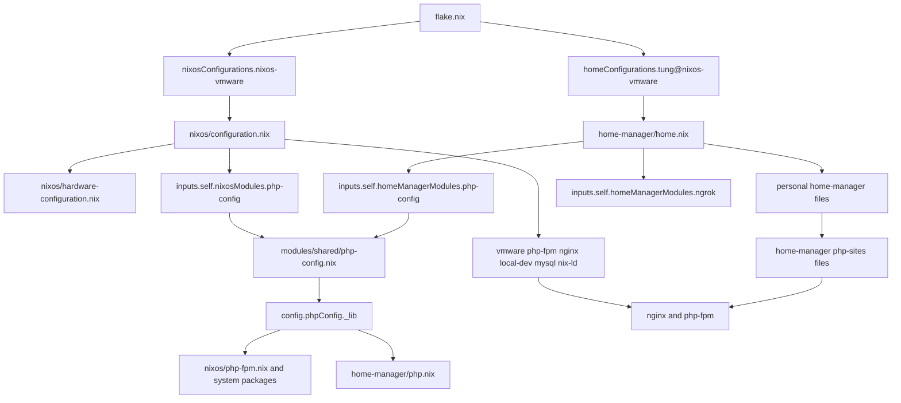

# System, User, and Reusable Module Boundaries

This repository has two independently evaluated configuration products: the NixOS system `nixos-vmware` and the standalone Home Manager profile `tung@nixos-vmware`. The boundary is intentional: a system rebuild does not switch the user's Home Manager profile, and a Home Manager switch does not rebuild the host. The flake wiring and commands for both products are described in [Flake Outputs and Entry Points](./flake-and-entrypoints.md).

## Evaluation boundaries

The flake passes `inputs` into both entrypoints, but each output constructs its own package set, overlay list, and module graph. A module exported by the repository is only a reusable value until a consumer imports it; exporting `nixosModules.php-config` or `homeManagerModules.php-config` does not apply either module automatically.

*The diagram shows the repository imports and the cross-layer PHP/site-service relationships used during configuration evaluation.*

### NixOS host layer

`nixos/configuration.nix` owns machine-wide policy and host services: networking and hostname, users and groups, boot-adjacent system settings, system packages, desktop services, Docker, firewall rules, and `system.stateVersion`. Its `imports` list is the host composition point. It imports the generated hardware file plus host-specific modules for VMware, PHP-FPM, Nginx, local development, MySQL, and Nix-ld.

Use this layer for anything that must exist in the system profile or be managed by a system service. The PHP versioned packages and Composer commands are installed here from the shared module's computed helpers, while the actual pools and service environment are defined by `nixos/php-fpm.nix`. Nginx is also a system service, and its vhost list is maintained in `nixos/nginx.nix` and `nixos/vhosts/`.

### Generated hardware state

`nixos/hardware-configuration.nix` is generated by `nixos-generate-config`, and `configuration.nix` imports it explicitly. It owns hardware-derived facts such as the boot loader device, initrd modules, root filesystem, swap file, and host platform. It is not the place for application services, user preferences, or reusable policy.

Treat this file as generated state: change it only when hardware or the generated machine description changes. Put deliberate host policy in `nixos/configuration.nix` or a focused host module instead. If hardware is regenerated, review the resulting filesystem, boot, kernel-module, and platform changes rather than hand-editing unrelated settings into the generated file.

### Home Manager user layer

`home-manager/home.nix` owns the `tung` user profile at `/home/tung`: user packages, session variables, program configuration, direnv integration, Home Manager activation behavior, and `home.stateVersion`. It imports personal feature files such as `php.nix`, `ssh.nix`, `git.nix`, and `pi-sandbox.nix`, as well as reusable repository modules and external modules.

This layer is the right home for files and settings that belong in the user's home directory. For example, `home-manager/php.nix` creates the user-facing `php` and `composer` wrappers and provisions test-site `index.php` files below `~/php-sites/`. It does not own the PHP-FPM daemons or Nginx virtual hosts. Those are system responsibilities, even though they consume files placed by Home Manager.

The resulting integration is deliberately explicit: the Home Manager activation makes the site directories traversable, while Nginx is configured with `ProtectHome = "read-only"` and PHP-FPM is allowed to access the site tree. A change to the test sites can therefore require both outputs to be checked: the files are user-owned, but serving them is host-owned.

## Reusable module boundaries

### NixOS and Home Manager module indexes

`modules/nixos/default.nix` and `modules/home-manager/default.nix` are export indexes, not host configuration files. The NixOS index exports the shared `php-config` module as `nixosModules.php-config`. The Home Manager index exports both `ngrok` and the same shared module as `homeManagerModules.ngrok` and `homeManagerModules.php-config`.

Reusable modules should describe options and reusable behavior rather than encode this machine's personal composition. The `ngrok` module illustrates a Home Manager-specific boundary: it declares typed `programs.ngrok` options, validates that the module controls `version` and `endpoints`, installs a wrapper, writes static configuration through `xdg.configFile`, and creates the authtoken fragment during activation after the user Agenix service is started. A user configuration enables and supplies that module; the module does not decide which host services should exist.

### Shared PHP module

`modules/shared/php-config.nix` is intentionally consumable by both module systems. It defines typed global `common`, `fpm`, and `cli` settings plus per-version settings, then computes a read-only `phpConfig._lib` from `pkgs/php-lib.nix`. The module is imported into NixOS through `inputs.self.nixosModules.php-config` and into Home Manager through `inputs.self.homeManagerModules.php-config`.

The shared interface prevents PHP policy from drifting between consumers, but it does not erase ownership. NixOS consumes the helpers for system PHP packages, FPM pools, scan directories, and service environments. Home Manager consumes them for user-facing PHP configuration and wrappers. When adding a PHP version, update the shared version configuration and every consumer that explicitly names versioned packages, pools, or site files; importing the shared module alone does not create a pool or a command.

## Local host services as a cross-layer integration

The local development stack is a system-owned service boundary with user-owned content:

- `nixos/local-dev.nix` creates the `vm.local` DNS behavior, certificate directories, and the ordered `mkcert-vm-local` oneshot service. Nginx is ordered after certificate generation.
- `nixos/nginx.nix` imports the vhost files, attaches the local TLS certificate and key, opens ports 80 and 443, and serves the PHP sites through virtual hosts.
- `nixos/php-fpm.nix` defines the `php81`, `php82`, and `php83` pools, uses the shared PHP derivations, and configures the socket and filesystem access needed by Nginx.
- `home-manager/php.nix` supplies the site files and directory permissions under the user's home.

Adding a site is consequently a coordinated change, not just a new Home Manager file: add the matching FPM pool and vhost, register the vhost in `nixos/nginx.nix`, provision the site root in Home Manager, and rebuild the NixOS output. The repository's Nginx module documents this sequence and the matching `fastcgi_pass` socket requirement.

## Lifecycle and safe change workflow

1. **Classify ownership.** Put hardware facts in the generated file only when hardware-driven; put host services and system packages in `nixos/`; put user files and preferences in `home-manager/`; put reusable options in the appropriate module index; put behavior shared by both module systems in `modules/shared/`.
2. **Wire imports explicitly.** A new reusable module must be exported by its index and imported by each consumer. A new host or user file must be added to that layer's `imports` list (or another explicit file list such as Nginx's vhosts).
3. **Track new files before evaluation.** Nix flake evaluation may not import a newly created file until it is tracked. Run `git add` for new files before `nix eval`, `nix flake check`, `nixos-rebuild`, or Home Manager evaluation; this is especially important for new vhosts and modules.
4. **Validate the affected output separately.** Use `sudo nixos-rebuild switch --flake .#nixos-vmware` for host state and `home-manager --flake .#tung@nixos-vmware switch` for user state. If both layers changed, validate and apply both; success of one output does not prove the other sees the same overlays, imports, or options.
5. **Preserve state-version semantics.** `system.stateVersion` and `home.stateVersion` are migration compatibility controls, not routine release-version knobs. Do not change them merely because the flake inputs or operating-system release changes.

The key invariant is explicit visibility: an output can use only the inputs, overlays, modules, and files wired into its own evaluation graph. Generated hardware state, system policy, user state, reusable module definitions, and local service consumers may collaborate, but none silently owns another layer's state.
