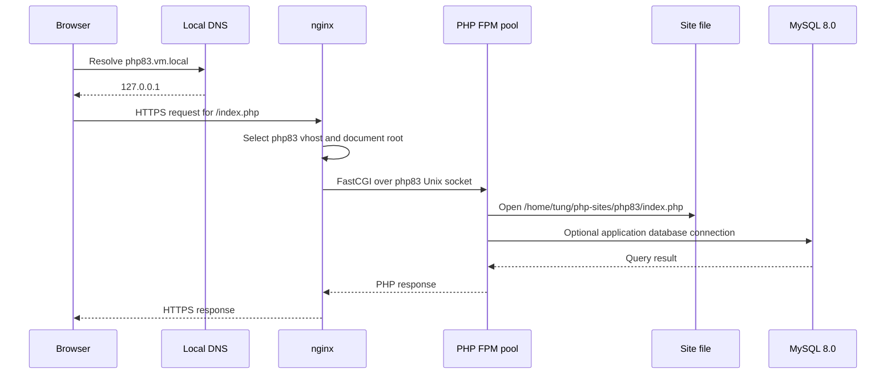

# Local PHP Web Runtime

The local web stack is a versioned PHP runtime behind system nginx. The three example sites are `php81.vm.local`, `php82.vm.local`, and `php83.vm.local`; each has a matching nginx virtual host, PHP-FPM pool, and site directory under `/home/tung/php-sites/`. The version selected by a web request is therefore determined by the vhost, not by the user's interactive `php` command.

## Request path

`dnsmasq` maps the `vm.local` suffix to `127.0.0.1`. `systemd-resolved` is configured with `~vm.local`, while dnsmasq answers the local wildcard mapping. The firewall opens TCP ports 80 and 443, and nginx adds TLS to every loaded local vhost using the certificate generated for `vm.local` and `*.vm.local`.



This sequence shows the browser-to-PHP boundary; MySQL is an application dependency reached by PHP code, not a hop performed by nginx.

### mkcert and nginx startup dependency

`mkcert-vm-local.service` runs once after `network-online.target`, creates `/var/lib/local-certs/vm.local.pem` and `/var/lib/local-certs/vm.local-key.pem`, and sets the certificate files to `root:nginx` with the key mode `0640`. nginx both `wants` and starts `after` this service, so nginx does not start before the TLS files exist. The mkcert state directory is `root:mkcert`, with user `tung` in the `mkcert` group for local certificate management.

## nginx virtual hosts and PHP-FPM selection

`nixos/nginx.nix` imports each file in its `vhostFiles` list and converts its `serverName` into the `services.nginx.virtualHosts` key. It adds the shared TLS settings (`addSSL = true`) to every imported vhost. A PHP vhost has two important locations:

- `/` uses `try_files $uri $uri/ /index.php?$query_string`, so a missing route falls back to the site's front controller.
- `~ \\.php$` includes nginx's FastCGI parameters, sets `SCRIPT_FILENAME` to `$document_root$fastcgi_script_name`, and passes the request to the socket exported by the corresponding pool.

For example, `php83.vm.local` roots at `/home/tung/php-sites/php83` and passes PHP requests to `config.services.phpfpm.pools.php83.socket`; php81 and php82 follow the same one-vhost-to-one-pool pattern. The socket path is obtained from the NixOS PHP-FPM module rather than hard-coded, so changing the pool declaration changes the generated endpoint consumed by the vhost.

To add a site safely, create its site file, add a matching `services.phpfpm.pools` attribute, add the vhost file to `vhostFiles`, and provision the corresponding home-manager site root. The vhost's `serverName`, root, and pool socket must remain aligned.

## Pools, sockets, and PHP configuration

`nixos/php-fpm.nix` defines dynamic pools `php81`, `php82`, and `php83`. Each pool runs workers as user `tung` and group `users`, uses the matching `phpPkg` from the shared PHP configuration library, and has eight maximum children. The generated Unix sockets are owned by `nginx:nginx` with mode `0660`; nginx is also added to the `users` group so it can access the site files and communicate with the pool boundary.

The FPM services set `catch_workers_output = yes` and enable PHP error logging through `php_admin_flag[log_errors]`. Each service receives a process-level `PHP_INI_SCAN_DIR` from `phpConfig._lib`. The scan path combines the PHP package's extension directory with a generated custom INI containing, in order, common, FPM-wide, version-common, and version-FPM settings. Keeping this variable at the service environment level is important: PHP-FPM reads it while starting, before pool configuration is processed. CLI wrappers use the analogous CLI scan directory, while home-manager's `php` and `composer` commands point at the PHP 8.3 wrappers.

The PHP packages come from the `nix-phps` overlay. The repository's PHP 8.1, 8.2, and 8.3 overlays compile zlib into PHP and enable OpenSSL-backed libzip; the shared PHP library then supplies versioned wrappers and FPM/CLI configuration. This is the build/configuration boundary, while the nginx vhost and FPM pool are the request-serving boundary.

## Files, permissions, and systemd sandboxing

The test `index.php` files are home-manager entries under `~/php-sites/php81`, `php82`, and `php83`. They are symlinks into the Nix store, whose files are already world-readable. Home-manager's activation makes the site root and each version directory `o+rx`, allowing nginx to traverse `/home/tung/php-sites/...` without changing the store files.

There are two non-obvious `ProtectHome` exceptions:

- NixOS's nginx service defaults to `ProtectHome=true`, which hides `/home` from nginx. `nixos/nginx.nix` changes it to `read-only`; nginx can see and read the site tree but is not granted general write access.
- Each NixOS PHP-FPM service also defaults to `ProtectHome=true`. The three pool services force `ProtectHome=false`, otherwise workers running as `tung` could not open scripts in the home-directory site roots.

These overrides are complementary, not interchangeable: nginx needs visibility to serve/static-route files and connect requests to FPM, while the FPM worker needs visibility to execute the selected script. If a new site is readable by its owner but its parent directories are not traversable, or if either sandbox override is removed, requests commonly fail as missing files or FastCGI/script-open errors even though the Nix paths and socket names evaluate correctly.

## MySQL boundary and compatibility constraint

`nixos/mysql.nix` enables MySQL with `pkgs.mysql80`. The main flake tracks newer nixpkgs, where MySQL 8.0 was dropped, so `overlays/default.nix` imports `mysql80` from the pinned `nixpkgs-2511` input. The system configuration applies that `mysql80-packages` overlay before importing the MySQL module. This pin is an intentional compatibility constraint for the local LAMP stack: changing the package source or removing the overlay can make evaluation fail or replace the expected MySQL 8.0 runtime.

PHP applications may connect to this local MySQL service using their normal database configuration, but the web runtime does not provision schemas or credentials in these modules. Database lifecycle and application-level connection settings remain outside the nginx-to-FPM socket contract.

## Operations and focused checks

After changing a pool, vhost, certificate dependency, or permission rule, rebuild the system with:

```sh
sudo nixos-rebuild switch --flake '.#nixos-vmware'
```

Useful boundary checks are:

1. Confirm `systemctl status mkcert-vm-local nginx phpfpm-php81 phpfpm-php82 phpfpm-php83 mysql` and verify nginx starts after the certificate service.
2. Check the generated configuration with `sudo nginx -t`; this catches an omitted vhost, invalid FastCGI socket reference, or unavailable TLS file.
3. Request each hostname over HTTPS and inspect nginx/FPM logs if the response is a 404, 502, or script-open error. A 502 points first to the pool/socket boundary; a script-open error points first to `ProtectHome` or directory traversal.
4. From a PHP test page or application, verify the expected PHP version and database connection independently; nginx does not select MySQL or alter PHP's database configuration.

The extension point is deliberately mechanical: a new PHP version or site needs a package/configuration entry, a pool, a vhost, and a readable site root. Keeping those four names and paths synchronized preserves the runtime invariant that every PHP request has exactly one intended FPM pool and executable script path.
