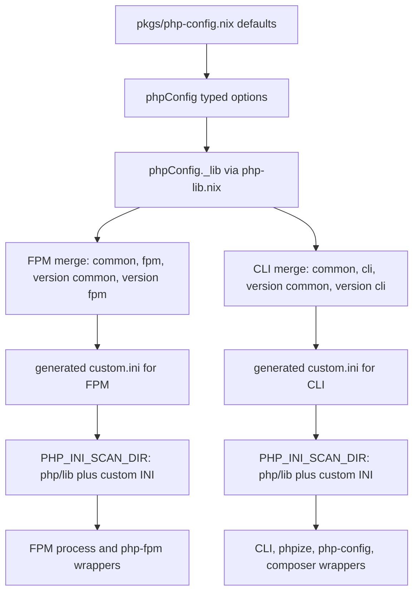

# Centralized PHP Versions and INI Composition

This repository keeps PHP settings in one small model and derives the runtime
artifacts from it. The supported version identifiers are `php81`, `php82`, and
`php83`; they are attribute names, package names, and the keys used by the NixOS
FPM pools. The source of default values is [`pkgs/php-config.nix`](../../pkgs/php-config.nix).
The shared module exposes those values as typed options, while
[`pkgs/php-lib.nix`](../../pkgs/php-lib.nix) performs the derivation and wrapper
work.

## The configuration model

Importing `modules/shared/php-config.nix` (exported for both NixOS and
Home Manager) creates `phpConfig` options:

- `phpConfig.common` is a `lines` option applied to every version in both
  execution modes.
- `phpConfig.fpm` is a `lines` option applied to every version only when PHP
  runs through FPM.
- `phpConfig.cli` is a `lines` option applied to every version only for CLI
  tools.
- `phpConfig.versions` is an attribute set of typed per-version submodules.
  Each entry has its own `common`, `fpm`, and `cli` `lines` options. Keys are
  package-style identifiers such as `php81`, `php82`, and `php83`.

The module's defaults are imported from `pkgs/php-config.nix`, rather than
repeating defaults in the module. The current defaults leave `common` empty,
set FPM `memory_limit = 128M`, and set CLI `memory_limit = 1G`; all three
version-specific entries are currently empty. A consumer can override a layer
without changing the computation code.

The module also publishes a read-only internal result at
`config.phpConfig._lib`. It contains computed per-version values such as
`phpPkg`, merged INI strings, scan-directory values, and wrapper derivations.
This is the boundary between declarative options and consumers: consumers read
`_lib`, rather than rebuilding the merge themselves.

## Merge order and FPM/CLI separation

INI text is concatenated in a fixed order, omitting empty layers. FPM uses:

```text
common → fpm → versions.<ver>.common → versions.<ver>.fpm
```

CLI uses the analogous but deliberately separate sequence:

```text
common → cli → versions.<ver>.common → versions.<ver>.cli
```

Thus a setting in the global FPM layer cannot accidentally become a CLI
setting, and a CLI-only setting such as the larger command-line memory limit is
not applied to workers. Within a resulting string, later lines are later in
the generated custom INI, so changing a more specific layer is the intended
way to override a broader value. The version-common layer is shared by that
version's FPM and CLI outputs, while the mode-specific layer is not.



*The flow shows the verified layer selection, scan-directory construction, and wrapper split.*

## Generated scan directories and wrappers

For each version, `php-lib.nix` resolves `pkgs.<version>` and writes the merged
content as a Nix text-file derivation at `/custom.ini`. The resulting
`PHP_INI_SCAN_DIR` is the PHP package's extension directory followed by that
custom directory, separated by `:`:

```text
<php-package>/lib:<generated-custom-ini>
```

This preserves the extension INI files supplied by the PHP package while adding
the repository's settings. The generated value is exposed separately as
`fpmIniScanDir` and `cliIniScanDir`.

For every available executable in the PHP package (`php`, `php-fpm`, `php-cgi`,
`phpdbg`, `phpize`, and `php-config`), `versionedPkg` creates a shell wrapper
with names such as `php81`, `php81-fpm`, and `php81ize`. The wrapper exports the
appropriate scan directory and then `exec`s the store executable. Only the
literal `php-fpm` executable selects the FPM scan directory; the other
executables select the CLI directory. `defaultPkg` creates the same wrappers
without the version suffix, and `composerVersionedPkg`/`composerPkg` do the
same for Composer using the CLI scan directory.

The wrapper is important operationally: setting `PHP_INI_SCAN_DIR` on the
calling shell is not required, and a FPM pool does not need to impersonate a
CLI environment. The variable is attached to the process that starts PHP.

## Consumers and entrypoints

### NixOS FPM

`nixos/configuration.nix` imports the exported `php-config` module and installs
the versioned PHP and Composer packages in `environment.systemPackages`. The
three pools in `nixos/php-fpm.nix` use the corresponding `phpPkg` and assign
`v81.fpmIniScanDir`, `v82.fpmIniScanDir`, or `v83.fpmIniScanDir` to the
process-level `PHP_INI_SCAN_DIR` of `phpfpm-php81`, `phpfpm-php82`, and
`phpfpm-php83`. This must be a systemd service environment value: FPM reads
its scan directory while starting, before pool configuration is processed.
The pool settings (socket ownership, worker limits, and logging) remain FPM
pool settings, not INI layers.

### CLI and Home Manager

The versioned system wrappers provide the explicit CLI entrypoints
`php81`, `php82`, `php83` and their matching Composer commands. Home Manager's
`home-manager/php.nix` intentionally installs only lightweight user-level
forwarders: `~/.local/bin/php` and `~/.local/bin/composer` execute the system
`php83` and `composer83` wrappers. Consequently the convenient unversioned
Home Manager commands use PHP 8.3's **CLI** INI, while users can select a
version explicitly with the versioned commands.

### Development shells

The flake's `mkSystemPhpShell` creates project-local `.direnv/php-bin/php`
and `composer` shims. For the active shell, those shims execute
`/run/current-system/sw/bin/php${version}` and
`/run/current-system/sw/bin/composer${version}`, then prepend the directory to
`PATH`. The `prbot` shell currently selects version `82`; commented examples
show `83`. Because these resolve to the system versioned wrappers, they inherit
the same generated CLI scan directory. The shell code does not independently
merge INI text; `php-lib.nix` is also exposed as `pkgs.phpLib` for code that
needs to construct helpers outside the module system, while the current shell
entrypoint consumes the installed wrappers.

## Safe changes and failure boundaries

- Change cross-version defaults in `pkgs/php-config.nix`; use the global
  `phpConfig.common`, `phpConfig.fpm`, or `phpConfig.cli` options for a
  configuration-level override.
- Put a setting shared only by one version in
  `phpConfig.versions.<ver>.common`, and put mode-specific settings in that
  entry's `fpm` or `cli` layer. Do not put FPM pool directives such as `pm` or
  socket ownership in INI text; those belong in `nixos/php-fpm.nix`.
- Keep the version keys aligned with available `pkgs.<name>` attributes. The
  computation dynamically evaluates `pkgs.${name}`, so an unknown key fails
  during evaluation rather than silently producing a wrapper.
- When changing wrapper behavior, preserve the distinction that only
  `php-fpm` receives FPM settings and all other generated executables,
  including Composer, receive CLI settings.
- After changing configuration, evaluate the NixOS or Home Manager
  configuration and exercise a versioned command such as `php83 -i` or
  `composer83`; for an FPM change, inspect the matching systemd service
  environment and the served version-specific test site. These checks cover
  both the generated wrapper path and the process-level FPM path.

The architecture overview has related runtime context in
[`PHP runtime`](../architecture/php-runtime.md), while the flake entrypoints
and overlay wiring are described in [`layered configuration`](../architecture/layered-configuration.md).
