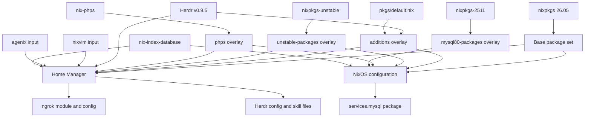
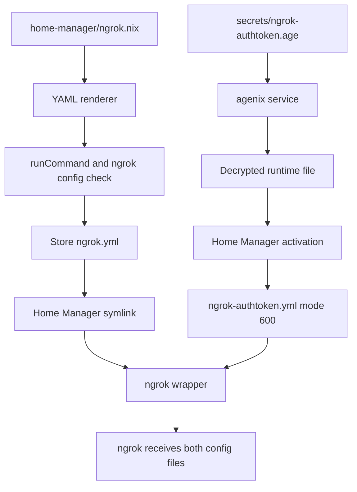

# External Inputs, Overlays, and Secret Delivery

This repository is a flake that composes several independently pinned inputs, then exposes them to NixOS and Home Manager through overlays and modules. The primary package universe follows `nixos-26.05`; compatibility inputs are deliberately kept separate rather than mixed into the default package set:

- `nixpkgs` is the primary input at `nixos-26.05`.
- `home-manager` follows `release-26.05` and follows the primary `nixpkgs` input.
- `nixvim` follows `nixos-26.05` and supplies the Home Manager module used by `home-manager/nixvim.nix`.
- `nixpkgs-unstable` remains an explicit unstable input, exposed as `pkgs.unstable` rather than replacing the primary package set.
- `nixpkgs-2511` remains on `nixos-25.11` because MySQL 8.0 is no longer available in newer nixpkgs; it is consumed only through the `mysql80-packages` overlay.
- `phps` supplies additional PHP versions through its overlay.
- `agenix`, `nix-index-database`, and `herdr` provide secret management, searchable Nix package metadata, and the Herdr terminal multiplexer plus agent files respectively.

`flake.lock` records the resolved revisions. The lock graph is authoritative for reproducibility; the branch declarations in `flake.nix` explain the intended compatibility policy.

## Input-to-overlay-to-consumer map

This shows package composition, not a runtime dependency graph. The overlays are exported by `flake.nix`; each consumer chooses which overlays or external modules to apply.

## Where overlays are applied

The standalone Home Manager output imports the primary package set with `additions`, `modifications`, `unstable-packages`, `phps`, and `inputs.herdr.overlays.default`. The same overlay family is applied by `home-manager/home.nix` for the user configuration. Consequently, user-facing packages such as `unstable.postman`, `unstable.uv`, `unstable.zed-editor`, `herdr`, and custom packages are available from the intended package namespace.

The NixOS configuration applies `additions`, `modifications`, `unstable-packages`, `phps`, and `mysql80-packages`. The latter defines `pkgs.mysql80` by importing `nixpkgs-2511` for the host system. `nixos/mysql.nix` then selects that package for `services.mysql`; changing the legacy input or removing the overlay changes the local LAMP database package and is not an innocuous cleanup.

The `additions` overlay imports `pkgs/default.nix`, exposing custom derivations both as flake packages (`nix build .#<name>`) and as `pkgs.<name>`. It also builds `herdrAgentFiles` from the Herdr flake source. The `modifications` overlay changes shared package behavior: it aliases Docker to `docker_29`, enables OpenSSL support in `libzip`, and rebuilds PHP 8.1, 8.2, and 8.3 with static zlib and the required zip behavior. The `unstable-packages` overlay imports unstable for the host platform and applies the repository's Postman override before publishing it as `pkgs.unstable`.

## External modules and feature consumers

`home-manager/home.nix` imports the repository's exported `ngrok` and PHP modules, the external Nixvim Home Manager module, the local agenix and Herdr configuration, and the standard `nix-index-database.homeModules.default`. It enables Nixvim and imports `home-manager/nixvim.nix`, so the external module is the boundary while the editor policy remains local.

The NixOS output imports `nix-index-database.nixosModules.default` alongside `nixos/configuration.nix`. The database input therefore participates at both system and user-module boundaries. Agenix is added as `agenix.homeManagerModules.default` to the standalone Home Manager output; the local `home-manager/agenix.nix` declares the identities and encrypted secret files consumed by activation scripts.

Herdr has two distinct integration paths. The package and upstream overlay make the executable available to Home Manager, while `home-manager/herdr.nix` generates a TOML baseline and copies it into the writable user configuration only when it is absent or still a symlink. Its agent skill files are linked from `pkgs.herdrAgentFiles`, allowing the upstream flake source to provide knowledge for both Pi and OpenCode. Existing writable Herdr settings are intentionally preserved so an operator can test `herdr server reload-config` before folding changes back into Nix.

## Ngrok: immutable static configuration, runtime secret fragment

The repository's ngrok module separates public configuration from the credential. `home-manager/ngrok.nix` selects `pkgs.unstable.ngrok`, supplies three named endpoints and their host-header policies, and points `authtokenFile` at the agenix-managed ngrok secret. It does not put the token into the Nix expression or the store.

The module in `modules/home-manager/ngrok.nix` renders `version`, top-level settings, and endpoint definitions to YAML with `pkgs.formats.yaml`. A `runCommand` puts that YAML in the store and runs `ngrok config check --config` against it during the build. Home Manager symlinks the validated result as `~/.config/ngrok/ngrok.yml`; this is the static, non-secret half.

During Home Manager activation, an ordered activation step starts `agenix.service`, creates `~/.config/ngrok` with mode `700`, creates the authtoken fragment with mode `600`, and writes the decrypted token into `ngrok-authtoken.yml`. The value is not documented here. A wrapper named `ngrok` always passes both the activation-written fragment and the static YAML via two `--config` arguments, so the credential and endpoint configuration are merged only when the command runs.

The module asserts that callers cannot provide `version` or `endpoints` through the freeform `settings` attribute because those keys are owned by the module. To add an endpoint, change `home-manager/ngrok.nix` rather than hand-editing the generated file. To change the shape of the static document, change the renderer and retain its build-time `config check`.

The build path validates only the secret-free document; the activation path is the only path that materializes the credential fragment. This distinction is the security and lifecycle invariant: static edits can be evaluated and checked without secret values, while secret delivery requires a working agenix identity and user service at activation time.

## Other agenix activation behavior

`home-manager/agenix.nix` uses `/home/tung/.ssh/ssh_agenix` as the identity path and declares encrypted files for the ngrok authtoken and GitHub token. A separate activation step starts `agenix.service`, creates `~/.config/nix` with mode `700`, creates `nix.conf` with mode `600`, and writes the GitHub access-token setting by concatenating the decrypted file. This is deliberately an activation-time write rather than `nix.settings`, because a store symlink would conflict with the required writable runtime file.

If activation cannot start the agenix user service, both the ngrok fragment and the GitHub token configuration can be absent or stale even though evaluation and the static ngrok build succeed. Troubleshooting should therefore distinguish evaluation/build failures from activation/identity failures, and should inspect file permissions and service state without printing secret contents.

## Safe change guide

1. Keep the primary `nixpkgs`, Home Manager, and Nixvim branches aligned with 26.05 unless a compatibility change is intentional.
2. Do not move MySQL 8.0 to the primary package set: preserve `nixpkgs-2511` and the `mysql80-packages` overlay until the local database stack is migrated.
3. Consume unstable packages through `pkgs.unstable`; do not silently replace `pkgs` with an unstable import.
4. Apply an overlay at the consumer that needs it, and check both standalone flake outputs and the NixOS/Home Manager entrypoints after changing overlay order.
5. Keep secrets in encrypted agenix inputs and activation-written files. Never interpolate secret values into Nix expressions, generated static YAML, documentation, or logs.
6. For ngrok changes, first verify the generated static YAML's build-time `ngrok config check`, then verify activation and the wrapper's two-config invocation without exposing the token.

For the top-level output and entrypoint model, see [Flake and Entrypoints](../architecture/flake-and-entrypoints.md). The PHP-specific module boundary is described in [PHP Configuration](../concepts/php-configuration.md), and the sandbox's operational context is covered by [Pi Box Sandbox](../operations/pi-box-sandbox.md).
