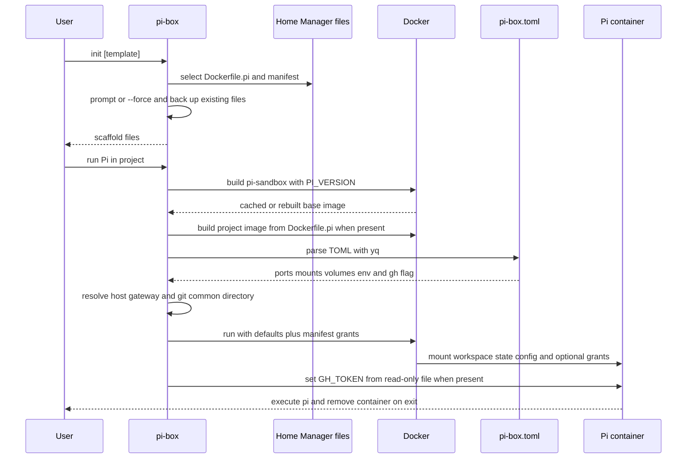

# Pi-Box Rootless Docker Sandbox

`pi-box` is the project-local launcher for running the Pi coding agent in a rootless Docker container. Home Manager installs the wrapper and deploys the shared base Dockerfile and template catalog under `~/.pi/sandbox`; the NixOS configuration enables the rootless Docker daemon. The image's `PI_VERSION` is pinned to `1.4.0` in the Home Manager module, so upgrading Pi requires rebuilding the base image on a subsequent run.

This sandbox is deliberately project-oriented rather than a general host shell: the workspace and Pi state are writable, Git and GitHub configuration are read-only, and all other host access must be explicitly declared in the project's untracked `pi-box.toml` (with the security exceptions described below).

## Deployment and image layers

`home-manager/pi-sandbox.nix` installs `pi-box`, substitutes the pinned version into the script, and deploys:

- `~/.pi/sandbox/Dockerfile`, sourced from `home-manager/pi-sandbox.Dockerfile`;
- `~/.pi/sandbox/templates`, a recursive tree of store-backed template files from `home-manager/pi-box-templates`.

The repository files are the source of truth. Because the scaffold names are globally ignored by Git, template files must be tracked explicitly—force-add them when necessary—or they will not be visible to the flake and will not be deployed.

The base image starts from `node:24-slim`, installs the common tools (`git`, `gh`, `ripgrep`, `fd`, `jq`, Python 3, and others), and installs `@earendil-works/pi-coding-agent@${PI_VERSION}`. Its stable OS and Git configuration layers precede the volatile Pi installation layer, preserving Docker cache reuse when the Pi version changes. The image also supplies container-safe Git defaults: the mounted host configuration provides identity, while the image clears host-only credential helpers and tools, uses `/usr/bin/gh auth git-credential` for GitHub HTTPS, and rewrites GitHub SCP-style remotes (`git@github.com:`) to HTTPS without changing the repository's configured remote.

On every run, the wrapper builds `pi-sandbox` from the deployed Dockerfile, passing `PI_VERSION` as a build argument. If the current directory contains `Dockerfile.pi`, it then builds a project image tagged from the directory name (lowercased and sanitized) with `FROM pi-sandbox`. Otherwise it runs the shared base image and reports that no project Dockerfile was found. Consequently, project toolchain changes are isolated to the project layer while common layers remain shared and cached.

The shipped templates are examples of that extension point. `default` is a generic scaffold; `php83` installs PHP 8.3, Composer, and the listed PHP extensions from sury.org; `java8` supplies Java 8 and Maven 3.6.3 and uses a persistent Maven volume; and the other catalog entries provide their respective project toolchains. Template selection only copies files into the project—it does not permanently register a project image.

## `init`: scaffolding without silent data loss

```text
pi-box init [template]
pi-box init --force [template]
pi-box init --list
```

With no name, `init` uses `default`. It validates that the selected deployed template has `Dockerfile.pi`; the manifest comes from that template when present, otherwise from `templates/default/pi-box.toml`. It then creates `Dockerfile.pi` and `pi-box.toml` in the current directory.

Existing scaffold files are handled as one batch. In a terminal, `init` asks once whether to back them up and overwrite; `--force` skips the prompt. Without a terminal, existing files are left untouched unless `--force` is supplied. When overwriting, each existing file is copied first to `<file>.<YYYYmmdd-HHMMSS>.bak`; all backups from that invocation share one timestamp. The implementation removes a destination before copying, preventing a project symlink from redirecting the write outside the project. `--list` prints templates that contain a `Dockerfile.pi`, and an unknown template fails before writing and reports the available names.

## Run flow and manifest control



The diagram shows the two entry paths and their shared run path. `pi-box` parses real TOML with `yq`; it does not use a shell parser. Supported manifest keys are:

- `ports`: Docker publish specifications, passed to `--publish`;
- `mounts`: extra host paths, mounted read-only at the same path inside the container;
- `volumes`: Docker volume specifications such as `pi-m2-example:/root/.m2`, which persist beyond the `--rm` container;
- `[env]`: extra `KEY=value` environment entries;
- `gh`: when false, suppresses the default read-only `~/.config/gh` mount.

An absent key produces no extra record, and GitHub configuration is enabled by default. `host.docker.internal` is the intended address for host services such as MySQL. The wrapper resolves it to the source address of the host's default route; this is preferred because rootless Docker's `host-gateway` can resolve to an inner bridge address that cannot reach host-bound services. It falls back to the literal `host-gateway` when route discovery is unavailable.

## Default grants and security boundary

A normal run uses `docker run --rm --interactive --workdir "$workspace"`. Interactive terminals additionally receive `--tty`. The workspace is mounted read-write at its host absolute path and is also the container working directory. Rootless Docker maps container root to the invoking host user, so files created in the workspace are not owned by an unrelated host UID.

The default host-backed resources are:

- the current project directory, read-write;
- `~/.pi/agent`, mounted read-write at `/root/.pi/agent`, sharing Pi's `auth.json`, settings, sessions, skills, and trust decisions with host Pi;
- `~/.config/git`, read-only, for Git identity and configuration;
- `~/.config/gh`, read-only, unless `gh = false` is set in the manifest.

When `.git` is a file (as in a worktree or some submodule layouts), the wrapper asks Git for the absolute `--git-common-dir`. If that directory is outside the workspace, it adds the common directory read-write at the same absolute path. A normal repository whose `.git` is a directory inside the workspace needs no additional Git mount. This extra mount is necessary for status, history, and commits to operate on the same repository metadata.

Configuration mounts account for Home Manager's symlinks into `/nix/store`: the wrapper mounts the host config directory read-only and separately resolves symlinked files so their targets are readable at the expected container paths. The global `~/.pi/agent/AGENTS.md` is handled similarly.

The boundary intentionally excludes `~/.aws`, `~/.ssh`, the 1Password agent socket, and every other host path not listed above or in the manifest. In particular, provider credentials are not copied into environment variables. Pi credentials and state are shared through the writable agent directory; Git/GitHub configuration is read-only. Extra mounts, ports, volumes, and environment variables come only from the project's untracked manifest, so review that file as an explicit grant list and avoid putting secrets in it.

### Optional GitHub token file

The host `gh` credential is held in an OS keyring and does not cross the container boundary. `~/.config/gh` contains configuration, not that keyring credential. If `~/.pi/sandbox/gh-token` exists, the wrapper checks its mode (warning unless it is `0600` or `0400`), mounts it read-only as `/run/pi-box/gh-token`, and uses a container-side shell to export its contents as `GH_TOKEN` immediately before `pi` starts. The token therefore is not placed in the host process arguments or Docker's inspected environment. If the file is absent, the container still starts and GitHub commands simply remain unauthenticated. Prefer a narrowly scoped, fine-grained read-only token and protect the file with `chmod 600`.

## Operational checklist and safe changes

1. Apply Home Manager before using a new base or template; a missing deployed Dockerfile or template produces an actionable error asking for the Home Manager application.
2. Rebuild naturally by running `pi-box` after changing `pi-sandbox.Dockerfile`, `Dockerfile.pi`, or the pinned Pi version; Docker caching makes unchanged layers cheap.
3. Use `pi-box init --list` to discover deployed templates, and use `--force` only when replacing local scaffold files is intended.
4. Keep `Dockerfile.pi` and `pi-box.toml` untracked as designed; the global ignore rule prevents project-specific toolchain and grant choices from entering repository history.
5. Treat changes to default mounts, token handling, Git URL rewriting, manifest parsing, and rootless Docker settings as security-sensitive. Validate both ordinary repositories and external Git common directories, plus a project with no manifest and one with ports, environment, a read-only mount, and a named volume.

The rootless daemon itself is configured in `nixos/configuration.nix`; Docker DNS is set to `1.1.1.1` and `8.8.8.8`, and the host firewall allows the configured TCP range. This system-level setup is separate from the Home Manager wrapper and is required before `pi-box` can build or run containers.
