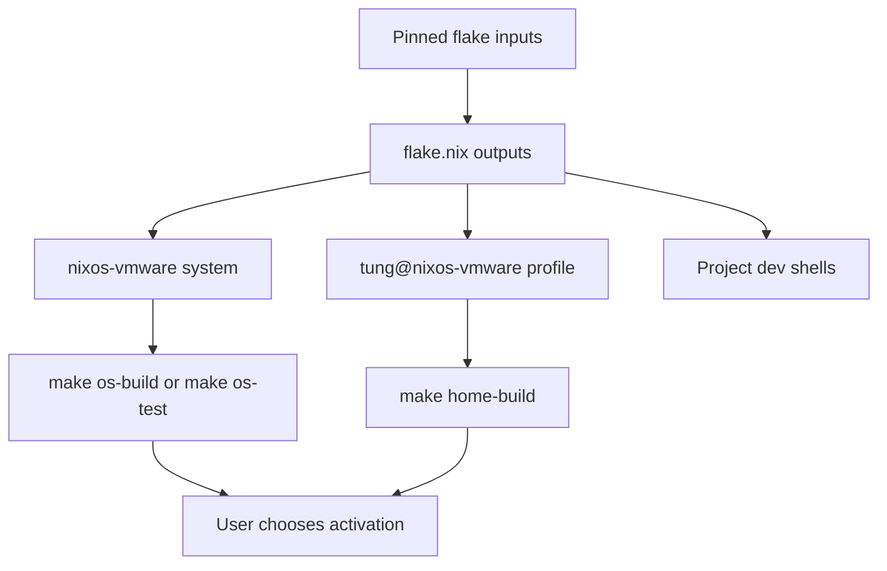

# Repository Quickstart

This repository is a flake-based configuration for one machine, `nixos-vmware`, and one user, `tung`. It deliberately keeps the host system and the user profile as separate flake outputs: `nixosConfigurations.nixos-vmware` is the NixOS entrypoint, while `homeConfigurations."tung@nixos-vmware"` is the standalone Home Manager entrypoint. The repository also exports reusable modules, overlays, packages, a formatter, and project development shells.

## Start here



*The flake turns pinned inputs into independently verifiable system, user, and development environments; activation remains a user decision.*

A normal agent change cycle is:

1. Identify the owning layer below and read the relevant architecture page.
2. Edit the existing module or entrypoint; do not introduce a new top-level directory.
3. If adding a file that Nix imports, `git add` it before evaluation because flakes only see tracked files.
4. Format changed Nix with `nixpkgs-fmt` (or use `make format` for the whole tree).
5. Verify only with `make home-build`, `make os-build`, or `make os-test` as appropriate.
6. Report the result and leave activation to the user.

### Safe agent boundary

Agents may run `make home-build`, `make os-build`, and `make os-test` for verification. These are the repository-approved build/test checks and do not perform the permanent `switch` operations. Agents must not run `make home`, `make os`, `nixos-rebuild switch`, `nh switch`, or any `sudo` operation. The user owns activation; for a major system upgrade, the user should consider `make os-boot` so the new generation is staged for reboot rather than switching the live desktop.

## Ownership and change routing

| Change | Edit first | Validate | More detail |
| --- | --- | --- | --- |
| Host packages, services, users, networking, desktop, Nix settings | `nixos/configuration.nix` or an imported `nixos/*.nix` module | `make os-build` | [Layered configuration](architecture/layered-configuration.md) |
| Generated hardware facts | `nixos/hardware-configuration.nix` only for hardware changes | `make os-build` | [Layered configuration](architecture/layered-configuration.md) |
| Per-user packages, shell, editor, SSH, Git, desktop-user tooling | `home-manager/home.nix` or an imported `home-manager/*.nix` module | `make home-build` | [Layered configuration](architecture/layered-configuration.md) |
| Reusable NixOS/Home Manager behavior | `modules/nixos/`, `modules/home-manager/`, or `modules/shared/` | The consuming build | [Flake outputs and entry points](architecture/flake-and-entrypoints.md) |
| New input, overlay, package, output, or dev shell | `flake.nix`, `overlays/`, or `pkgs/` | Relevant system/home build, plus shell evaluation | [Flake outputs and entry points](architecture/flake-and-entrypoints.md) |
| PHP versions, INI policy, wrappers, or consumers | `modules/shared/php-config.nix`, `pkgs/php-config.nix`, `pkgs/php-lib.nix` | `make os-build` and/or `make home-build` | [PHP configuration](concepts/php-configuration.md) |
| Local PHP site, nginx host, FPM pool, TLS, or database integration | `nixos/nginx.nix`, `nixos/php-fpm.nix`, `nixos/vhosts/`, and related host modules | `make os-test` when test-mode evaluation is useful | [PHP runtime](architecture/php-runtime.md), [Local web development](workflows/local-web-development.md) |
| Secrets, external flakes, overlays, or ngrok delivery | `flake.nix`, `overlays/`, `home-manager/agenix.nix`, or `home-manager/ngrok.nix` | Relevant build; never expose secret contents | [Inputs, overlays, and secrets](integrations/inputs-overlays-secrets.md) |
| Rootless project sandbox, templates, grants, or credentials | `home-manager/pi-sandbox.nix`, `home-manager/pi-box.sh`, or `home-manager/pi-box-templates/` | `make home-build`; user runs sandbox operations | [Pi-box sandbox](operations/pi-box-sandbox.md) |
| Formatting, flake evaluation, or CI/documentation behavior | `Makefile`, `.github/`, or the relevant workflow | See [Validation and CI](testing/validation-and-ci.md) | [Validation and CI](testing/validation-and-ci.md) |

## Configuration shape

`flake.nix` pins the primary `nixpkgs` and Home Manager release branches to `26.05`, keeps `nixpkgs-unstable` available through an overlay, and retains `nixpkgs-2511` for the legacy `mysql80` package used by the local development stack. It wires the repository's overlays and reusable modules into both configuration entrypoints. The system imports generated hardware state plus host modules for VMware, PHP-FPM, nginx, local development, MySQL, and dynamic linking. Home Manager imports the reusable ngrok and PHP configuration modules, Nixvim, and the personal modules for credentials, shells, tools, development languages, and the Pi sandbox.

The system layer owns machine-wide state such as the `nixos-vmware` hostname, the `tung` account, GNOME, Docker, firewall, system packages, and local web services. The Home Manager layer owns `/home/tung`, user packages, shell/editor configuration, direnv, and user services. Shared modules are the extension point when an option or behavior must be consumed by both layers; local host modules are preferable for behavior that belongs only to this machine.

## Common workflows

### System or user configuration

Use the narrowest build after an edit:

```bash
make os-build       # changes under nixos/ or system-facing modules
make os-test        # test-mode NixOS evaluation when specifically needed
make home-build     # changes under home-manager/ or Home Manager modules
```

`make format` formats every `.nix` file with `nixpkgs-fmt`; `nix flake show --no-write-lock-file` performs a lightweight output check, and `nix flake check --no-write-lock-file` is the deeper flake evaluation check. `make update` intentionally changes pinned inputs and should be treated as a separate, reviewable change.

The corresponding activation commands are user-only:

```bash
make home
make os
```

The first switches the `tung@nixos-vmware` Home Manager profile; the second uses `nh` to switch the `nixos-vmware` system and also installs the mkcert trust store. Do not substitute these commands during agent verification.

### Project development

Project shells are exposed by `flake.nix` and selected through direnv. Add a shell definition to `devShells`, then put `use flake /home/tung/code/nix-configs#<shell-name>` in the project `.envrc` and run `direnv allow` as the user. The PHP shell helper creates project-local `php` and `composer` wrappers, while the Java and Node shells pin the toolchains needed by their projects. For local sites, use the versioned PHP binaries and the nginx/FPM procedure in [Local web development](workflows/local-web-development.md).

### Pi-box operations

Home Manager deploys the Pi sandbox base image and templates. `pi-box` then builds a per-project image from `FROM pi-sandbox`, mounts the project and explicitly permitted state, and runs it rootlessly. The default boundary excludes AWS credentials, SSH credentials, the 1Password socket, and unrelated host paths; GitHub credentials require the separately provisioned sandbox token. Read [Pi-box sandbox](operations/pi-box-sandbox.md) before changing grants or mounts.

## Failure and safety notes

- Keep `flake.lock` changes intentional: ordinary validation commands use `--no-write-lock-file`.
- A new imported file must be tracked before evaluation can see it.
- Do not edit `nixos/hardware-configuration.nix` for ordinary system or service changes; it is generated hardware state.
- PHP version changes affect multiple consumers—FPM, CLI wrappers, Home Manager, and project shells—so use the centralized PHP configuration documentation rather than changing one generated consumer in isolation.
- A build or test proves evaluation/build behavior, not that activation is safe for the current desktop. The user must review and apply generations.

## Task-routing map

- **Architecture:** [Flake outputs and entry points](architecture/flake-and-entrypoints.md) and [System, user, and reusable module boundaries](architecture/layered-configuration.md)
- **Local runtime and development:** [Local PHP web runtime](architecture/php-runtime.md), [PHP configuration](concepts/php-configuration.md), and [Developing and adding local sites](workflows/local-web-development.md)
- **Operations and integrations:** [Pi-box rootless Docker sandbox](operations/pi-box-sandbox.md) and [External inputs, overlays, and secret delivery](integrations/inputs-overlays-secrets.md)
- **Validation and delivery:** [Validation, evaluation, and OpenWiki CI](testing/validation-and-ci.md) and [Change, validate, and apply configuration](workflows/change-validate-apply.md)
