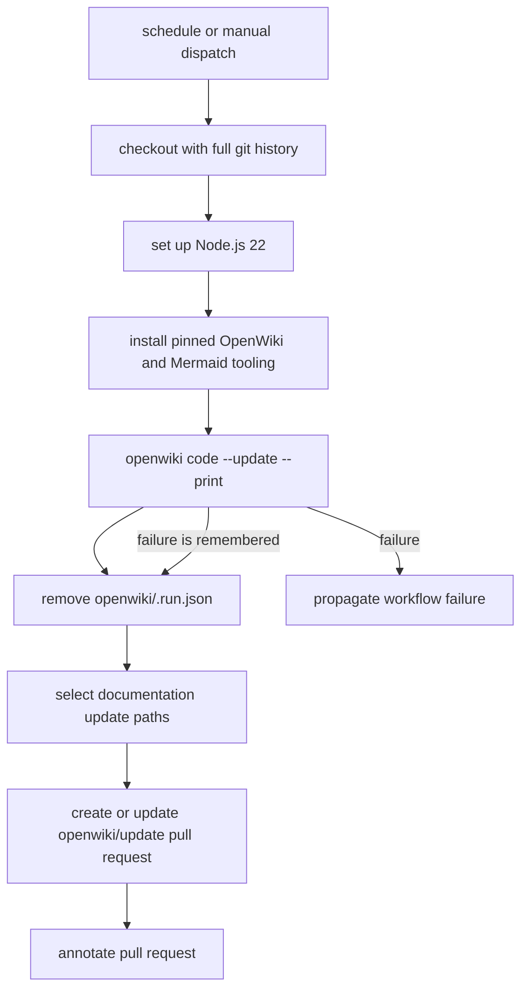

# Validation, Evaluation, and OpenWiki CI

This repository is a flake-based NixOS and Home Manager configuration, not an application with a conventional unit-test suite. Validation therefore has three different meanings:

1. **Evaluation and build checks** ask Nix to resolve the flake and construct an output without changing the running machine.
2. **Activation** applies a generated system or user configuration; it is an operational change, not a test assertion.
3. **Application-level tests** exercise a program or service. The repository has no general test runner; `test.php` is a focused, standalone PHP/ZIP experiment rather than a suite for the configuration.

The output to validate depends on ownership. The flake exposes `nixosConfigurations.nixos-vmware` for the host and `homeConfigurations."tung@nixos-vmware"` for the user profile. A successful check of one does not prove the other sees the same modules, overlays, or options; see [Flake Outputs and Entry Points](../architecture/flake-and-entrypoints.md).

## Local validation commands

Run commands from the repository root. The commands below are the supported practical boundary documented in `AGENTS.md` and `Makefile`.

### Inspect and evaluate without applying

```console
nix flake show --no-write-lock-file
nix flake check --no-write-lock-file
```

`nix flake show` evaluates and displays the available outputs while explicitly avoiding a `flake.lock` write. `nix flake check` performs a deeper flake evaluation/check pass, also without updating the lock file. These commands may download inputs and populate the Nix store, but they do not switch NixOS or Home Manager and do not change the working tree.

For a narrower inspection, use `nix eval` against the relevant output; use `nix build` when the goal is to materialize a derivation rather than activate it. The flake's formatter is itself an output, so `nix fmt` is the flake-aware formatting entrypoint.

New files must be tracked before evaluation can import them. In practice, `git add` a new module, vhost, or other imported file before running these checks; this does not mean committing it.

### Build the affected configuration

```console
make home-build
make os-build
```

`make home-build` calls `nh home build . --configuration tung@nixos-vmware --max-jobs $(nproc) --no-write-lock-file --no-nom`; it builds the standalone Home Manager profile without switching it. Use it after changes under `home-manager/` or shared code consumed by that profile.

`make os-build` calls `nixos-rebuild build --flake ".#nixos-vmware"`; it evaluates and builds the NixOS system output without switching the running host or selecting it as the next boot generation. Use it after changes under `nixos/`, or when a shared change affects system configuration.

These are build checks, not application tests. They can fail on evaluation errors, missing imports, option/type errors, dependency resolution, or derivation build failures. They do not prove that every running service behaves correctly.

### Formatting

```console
make format
nix fmt
nixpkgs-fmt path/to/file.nix
```

`make format` finds every tracked-tree `.nix` path except `.git` and runs `nixpkgs-fmt` on them, so it can rewrite many files. `nix fmt` uses the formatter exported by `flake.nix` (`nixpkgs-fmt`) and formats the repository's Nix sources according to the flake formatter. `nixpkgs-fmt <file>` is the focused alternative. Formatting changes files but does not evaluate or activate them; review the resulting diff.

### Test-mode system evaluation

```console
make os-test
```

This invokes `nixos-rebuild test --flake ".#nixos-vmware"`. Unlike `make os-build`, `nixos-rebuild test` builds and activates a test-mode system configuration in the running host; it is not a unit/integration test suite and is not the normal permanent switch workflow. Use it only when test-mode activation is specifically needed. It must not be confused with `make os`, which invokes `nh os switch` and changes the live system as an ordinary activation.

The agent safety boundary is deliberate: agents may use `make home-build`, `make os-build`, and, when needed, `make os-test` for verification, but must leave `make home`, `make os`, `nh ... switch`, `nixos-rebuild switch`, and other privileged activation commands to the operator. `make os-boot` is also an operational command: it stages a system generation for the next reboot rather than merely checking it. For major upgrades, the repository guidance prefers boot staging so the current session is not disrupted.

## The only repository-local focused test

`test.php` creates `test.zip`, writes two files encrypted with `ZipArchive::EM_AES_256`, reopens the archive with the password, and verifies the contents. It then invokes the system `unzip` command and asserts the expected `need PK compat` incompatibility output for AES-256. Running it therefore requires PHP's ZIP support and `unzip`, writes or replaces `test.zip` in the current directory, and reports failures through its output/exit behavior. It tests ZIP/PHP tooling behavior; it does not validate the NixOS module graph, the Home Manager profile, or the deployed web stack.

There is no repository-wide `phpunit`, Jest, pytest, or NixOS VM test command in the checked-in validation instructions. To validate application behavior, run that application's own tests or exercise the relevant service after an appropriate build and operator-approved activation.

## OpenWiki update workflow

The workflow in [`openwiki-update.yml`](../../.github/workflows/openwiki-update.yml) runs on a daily schedule (`0 8 * * *`) and can also be started with `workflow_dispatch`. Its control flow is:



*This diagram follows the inspected control flow in `.github/workflows/openwiki-update.yml`; cleanup and pull-request creation are guarded against cancellation, while an OpenWiki failure is propagated after the PR step.*

The checkout uses `fetch-depth: 0`. Full history is required because `openwiki code --update` compares `HEAD` with the commit it last documented; a shallow clone can hide that baseline and produce an empty change summary. The job then installs Node.js 22 and pinned global packages: `openwiki@0.7.2`, `mermaid@11.16.0`, and `jsdom@29.1.1`. Mermaid and jsdom provide high-fidelity diagram validation.

The update command runs with the Copilot provider and model `gpt-5.6-luna`, plus the configured OpenWiki/LangSmith secrets and tracing environment. It is marked `continue-on-error: true` so the workflow can remove transient `openwiki/.run.json`, calculate the paths to stage, and open a pull request even when the update stops partway through. The staged set includes `openwiki`, `AGENTS.md`, and this workflow; `CLAUDE.md` is included only if it exists. The PR uses branch `openwiki/update`, commit/title `docs: update OpenWiki`, and explains that a failed run intentionally preserves pages completed before the failure. The final step exits non-zero when the OpenWiki command failed, so a PR can preserve progress without making the workflow appear successful.

The workflow declares `contents: write` and `pull-requests: write` permissions. Those permissions are required for the generated branch/commit and pull request; the workflow does not silently merge the result. Review and merge the PR to establish the completed pages as the next documented baseline.

## Change-to-check decision guide

- Changed only Nix formatting: run `nixpkgs-fmt` on the file or `nix fmt`, then inspect the diff.
- Changed Home Manager modules or user packages: run `make home-build`.
- Changed NixOS modules, services, packages, or host files: run `make os-build`; use `make os-test` only if test-mode activation is needed.
- Changed shared modules, overlays, or flake inputs: inspect the output graph and validate each affected output separately; do not infer Home Manager success from a NixOS build or vice versa.
- Need to apply a validated change: ask the operator to run the appropriate activation command. Validation is evidence for activation, not activation itself.

For the broader ownership and apply sequence, see [Layered Configuration](../architecture/layered-configuration.md) and [Flake Outputs and Entry Points](../architecture/flake-and-entrypoints.md).
