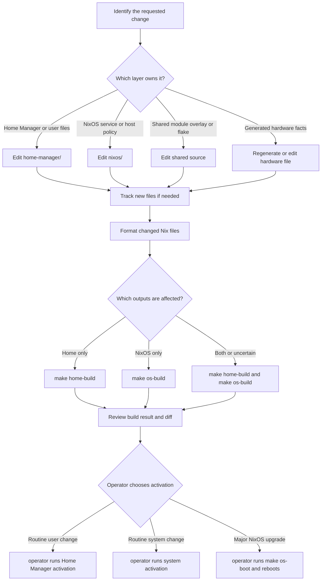

# Change, Validate, and Apply Configuration

This repository produces two separate configuration outputs from `flake.nix`: the NixOS host `nixos-vmware` and the standalone Home Manager profile `tung@nixos-vmware`. A change is not applied merely because it evaluates successfully, and validating one output does not validate the other. The safe workflow is therefore **classify ownership, wire the change, format it, build the affected output, and only then have the operator activate it**.

## Edit ownership

Use the narrowest owner that matches the behavior:

| Change | Edit here | Validate |
| --- | --- | --- |
| Hostname, users, system packages, desktop, firewall, Docker, Nix daemon policy, or system state | `nixos/configuration.nix` or a focused file imported by it | `make os-build` |
| Hardware-derived boot, filesystem, initrd, swap, or platform facts | `nixos/hardware-configuration.nix` only when hardware changed | `make os-build` |
| User packages, shells, dotfiles, session variables, user services, or Home Manager activation | `home-manager/home.nix` or an imported `home-manager/*.nix` module | `make home-build` |
| Behavior shared by NixOS and Home Manager, especially PHP options and computed helpers | `modules/shared/`, then consume the module from each affected layer | `make os-build` and/or `make home-build` |
| Package additions, overrides, overlays, flake inputs, outputs, or dev shells | `pkgs/`, `overlays/`, or `flake.nix` | Build every affected output; normally both builds for shared changes |
| Local PHP-FPM pools, Nginx virtual hosts, certificates, or MySQL | `nixos/php-fpm.nix`, `nixos/nginx.nix`, `nixos/vhosts/`, or the corresponding host module | `make os-build` |
| PHP site files under the user's home | the relevant Home Manager module, currently `home-manager/php.nix` | `make home-build`; also `make os-build` when the serving stack is affected |

Do not put application services or user preferences in `nixos/hardware-configuration.nix`; it is generated state. Conversely, Home Manager can create user-owned site files, but Nginx and PHP-FPM remain system responsibilities. A new file must be tracked with `git add` before flake evaluation can import it.

The flake makes the boundaries explicit: `nixosConfigurations.nixos-vmware` imports `nixos/configuration.nix`, while `homeConfigurations."tung@nixos-vmware"` imports `home-manager/home.nix`. Each output constructs its own package set, overlays, and module graph. When a shared module, overlay, input, or imported file changes, validate each consumer rather than assuming success in one layer proves the other.

## Edit-to-validation decision path

*This flowchart shows ownership, independent output validation, and the final operator-controlled apply choice.*

## Validate without applying

Run from the repository root. The repository's agent safety rule is strict: **the only allowed verification commands are `make home-build`, `make os-build`, and `make os-test`**. Never run `make home`, `make os`, `nh switch` (including `nh os switch` or `nh home switch`), or `nixos-rebuild switch` as agent verification. Those commands activate configuration and may change the live host or user profile.

- `make home-build` calls `nh home build . --configuration tung@nixos-vmware --max-jobs $(nproc) --no-write-lock-file --no-nom`. It builds the standalone user profile without switching it. Use it after Home Manager edits or shared changes consumed by Home Manager.
- `make os-build` calls `nixos-rebuild build --flake ".#nixos-vmware"`. It evaluates and builds the host output without switching the running system. Use it after NixOS edits or shared changes consumed by NixOS.
- `make os-test` calls `nixos-rebuild test --flake ".#nixos-vmware"`. This is a test-mode system activation, not a unit-test suite; use it only when test-mode evaluation is specifically needed. It is still the third and final command permitted for agent verification.

A successful build catches missing imports, option/type errors, dependency resolution problems, and derivation failures. It does not prove that every running service behaves correctly. For shared PHP or overlay changes, run both relevant build commands. For cross-layer site changes, build Home Manager for the files and NixOS for the Nginx/FPM consumers.

### Formatting and lockfile updates

`make format` runs `nixpkgs-fmt` over `.nix` files in the tree; `nix fmt` uses the formatter exported by the flake; and `nixpkgs-fmt path/to/file.nix` is the focused option. Formatting rewrites files but does not activate them, so inspect the diff afterward. These are repository maintenance commands, not substitutes for the allowed build verification commands.

`make update` runs `nix flake update` and changes `flake.lock`. Use it intentionally when refreshing pinned inputs, then review the lockfile and rebuild every affected output. The configured inputs primarily follow the `26.05` release branches; `nixpkgs-2511` remains on `nixos-25.11` for the legacy `mysql80` package. Do not combine an incidental input update with an unrelated configuration change without reviewing the resulting dependency and build impact.

## Apply validated changes safely

Activation is an operator action after the appropriate build succeeds. The Makefile's routine activation targets are `make home` for Home Manager and `make os` for the live NixOS host, but agents must not run either target. An operator should choose the layer matching the validated output; applying one does not apply the other.

For a **major NixOS upgrade**, use `make os-boot` as the intended user workflow, then reboot. It runs `nh os boot . --hostname nixos-vmware --max-jobs $(nproc) --no-write-lock-file`, staging the new generation as the next boot default without touching the current session. The previous generation remains bootable in the boot menu as a fallback. This is safer than an in-session switch for a major upgrade because switching can restart the display manager, kill the GNOME session and the terminal running the switch, and leave an operator with a disrupted session.

For ordinary changes, activation should happen only after the matching output has been built and the diff has been reviewed. If a change spans both layers, apply both outputs deliberately. Preserve `system.stateVersion = "25.11"` and `home.stateVersion = "25.11"` unless performing a planned state-version migration; changing flake inputs or the release branch alone is not a reason to change either value.

## Failure-safe checklist

1. Identify the owning layer and the output(s) that consume it.
2. Add imports, vhost registrations, pool definitions, or overlay exports explicitly; exports do not apply modules automatically.
3. Track new files before evaluation.
4. Format changed Nix files and review the diff.
5. Run only the permitted verification commands: `make home-build`, `make os-build`, and, when needed, `make os-test`.
6. Stop on failure; do not activate a partially validated output.
7. Have the operator apply the matching routine target, or use `make os-boot` plus reboot for a major NixOS upgrade so the previous generation remains available.

The central invariant is that evaluation/build and activation are different lifecycle stages: a build proves that an output can be constructed, while activation changes the machine or user profile. Keep those stages separate, and keep NixOS and Home Manager validation separate whenever their graphs differ.
