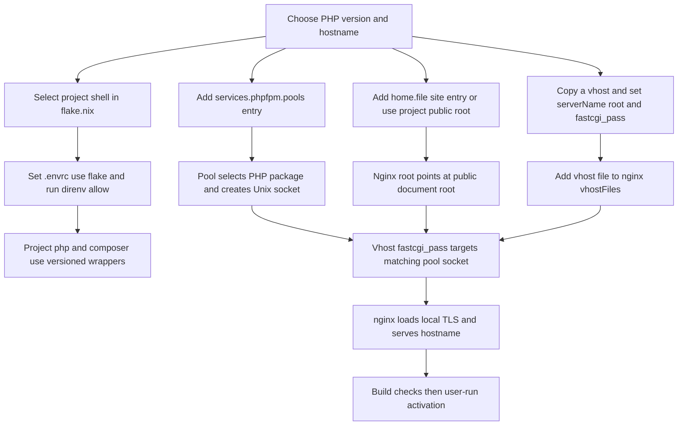

# Developing and Adding Local Sites

This repository provides two related local-development paths:

- **Project development:** a flake dev shell supplies a versioned `php` and `composer` selected by the project’s `.envrc`.
- **Browser testing and local applications:** NixOS runs PHP-FPM pools and nginx virtual hosts for `*.vm.local` names, with local TLS and DNS already configured.

The machine is `nixos-vmware`, the local user is `tung`, and the repository is normally checked out at `/home/tung/code/nix-configs`. The system currently exposes PHP 8.1, 8.2, and 8.3 packages and FPM pools. The `prbot` dev shell is currently wired to the `"82"` system wrapper (despite its adjacent comment describing the project as PHP 8.1), so inspect the flake before relying on a version.

## Choose the PHP CLI with a project dev shell

The flake’s `devShells` are evaluated per system with the repository’s PHP overlays. `mkSystemPhpShell` creates project-local executable wrappers in `$PWD/.direnv/php-bin`: `php` delegates to `/run/current-system/sw/bin/php${version}` and `composer` delegates to the matching `composer${version}`. That directory is prepended to `PATH`, so the project gets the selected version without replacing the user’s global default.

For an existing shell, create or update `.envrc` in the project root. For example, the documented shape is:

```zsh
use flake /home/tung/code/nix-configs#prbot
```

Then approve the shell:

```zsh
direnv allow
```

Entering the directory causes direnv (enabled with the zsh integration and `nix-direnv`) to load the flake shell. You can also evaluate it directly from the repository root without changing the environment permanently:

```zsh
nix develop .#prbot
```

Check that the selected tools are the intended ones before installing dependencies or running project commands:

```zsh
command -v php
php -v
command -v composer
composer --version
```

To add another project shell, add an attribute under `devShells` in `flake.nix`, normally using `mkSystemPhpShell "83"` or another supported version. For an EOL version below 8.2, use the PHP package made available by the `phps` overlay and ensure the versioned system wrapper exists. Add that shell’s name to the project’s `.envrc`, then run `direnv allow` again. The shell hook deliberately writes wrappers under the current project, so do not commit `.direnv` or treat the wrapper as a source-controlled application binary.

### User defaults and versioned packages

Home Manager puts `$HOME/.local/bin` on the session path and installs default `php` and `composer` wrappers that delegate to PHP 8.3:

```sh
exec /run/current-system/sw/bin/php83 "$@"
exec /run/current-system/sw/bin/composer83 "$@"
```

The system configuration installs the versioned PHP and Composer packages for 8.1, 8.2, and 8.3. A project shell takes precedence over these user defaults because its `.direnv/php-bin` directory is prepended to `PATH`. Keep this distinction in mind when a command works in an activated project but reports a different version in a normal shell.

## Existing browser test sites

Home Manager provisions these test entrypoints:

- `~/php-sites/php81/index.php` → `php81.vm.local`
- `~/php-sites/php82/index.php` → `php82.vm.local`
- `~/php-sites/php83/index.php` → `php83.vm.local`

Each entrypoint calls `phpinfo()` and `phpinfo(INFO_MODULES)`, making the effective PHP version and loaded modules visible in a browser. The corresponding nginx roots are `/home/tung/php-sites/php81`, `/home/tung/php-sites/php82`, and `/home/tung/php-sites/php83`; each vhost routes PHP requests to the matching FPM socket.

Open `https://php81.vm.local`, `https://php82.vm.local`, or `https://php83.vm.local` after system and Home Manager activation. `local-dev.nix` maps the `vm.local` DNS suffix to `127.0.0.1` through dnsmasq and resolved, and a boot-time `mkcert-vm-local` service creates a certificate covering `vm.local`, `*.vm.local`, `localhost`, and loopback addresses. nginx waits for that certificate service. The certificate is `/var/lib/local-certs/vm.local.pem` with key `/var/lib/local-certs/vm.local-key.pem`; the key is readable by the `nginx` group, not exposed through the site tree.

The nginx module enables HTTP and HTTPS firewall ports 80 and 443, adds the same local TLS settings to every listed vhost, and sets `ProtectHome = "read-only"` so nginx can read the site subtree. The FPM services separately disable `ProtectHome` because workers must open scripts below `/home/tung/php-sites`. Home Manager’s activation makes the site directories world-traversable (`o+rx`); the generated PHP files are store-backed and already world-readable.

## Add a project site, pool, and vhost

Use this workflow when a project needs its own `*.vm.local` hostname or a PHP version different from an existing site. A site is not complete until all three names agree:

1. **Site file:** the `root` contains the application’s public document root and the `serverName` is the hostname users will browse.
2. **FPM pool:** the pool selects the PHP package and owns the Unix socket used by nginx.
3. **Vhost registration:** the vhost file is included in `nixos/nginx.nix`’s `vhostFiles` list.



*The flow shows the separate CLI, site-file, pool, and vhost relationships, and the required socket and registration joins.*

### 1. Add or provision the site files

For a small test site managed by Home Manager, add a `home.file` entry in `home-manager/php.nix` (or another imported Home Manager module), for example a public entrypoint under `php-sites/my-site/index.php`. Also extend the `phpSitesDirPermissions` activation command so every new directory is traversable by nginx. If the application lives in a checked-out project, use its existing public directory instead, as `middleware.vm.local` does with `/home/tung/code/netsuite-middleware/middleware_main/public`; ensure the nginx and FPM access rules below still apply.

Do not point nginx at a project’s private or repository root when the framework has a `public` directory. The vhost examples use `try_files $uri $uri/ /index.php?$query_string` and pass `SCRIPT_FILENAME` to FPM. Framework sites also deny dot-files other than `.well-known` and use `error_page 404 /index.php`; copy those protections when the application requires them.

### 2. Add the PHP-FPM pool

In `nixos/php-fpm.nix`, add an attribute under `services.phpfpm.pools`. Follow the existing pools’ contract:

```nix
mySite = {
  user = "tung";
  group = "users";
  phpPackage = v83.phpPkg;
  settings = defaultPoolSettings;
};
```

Use the version object from `config.phpConfig._lib` that matches the desired runtime (`v81`, `v82`, or `v83`). `defaultPoolSettings` uses dynamic workers, eight maximum children, nginx-owned mode `0660` sockets, worker-output capture, and enabled PHP error logging. The NixOS pool name produces a service such as `phpfpm-mySite` and a socket available as `config.services.phpfpm.pools.mySite.socket`.

The pool runs workers as `tung:users`. nginx is placed in the `users` group so it can access the site files and communicate with the socket. For every pool that can execute scripts under `/home/tung/php-sites`, add a matching `systemd.services.phpfpm-mySite` override with `serviceConfig.ProtectHome = lib.mkForce false` and set `environment.PHP_INI_SCAN_DIR` to the selected version’s `fpmIniScanDir`. `PHP_INI_SCAN_DIR` must be a process environment variable: setting it only as an FPM pool `env[...]` value is too late for FPM startup.

### 3. Add and register the nginx vhost

Copy a representative file such as `nixos/vhosts/php83.vm.local.nix` to `nixos/vhosts/my-site.vm.local.nix`, then change:

- `serverName` to the actual hostname, for example `my-site.vm.local`;
- `root` to the application’s public directory;
- `fastcgi_pass` to `unix:${config.services.phpfpm.pools.mySite.socket}`.

Keep the PHP location’s FastCGI includes and set `SCRIPT_FILENAME` consistently with the chosen root. Then append `./vhosts/my-site.vm.local.nix` to `vhostFiles` in `nixos/nginx.nix`. nginx imports each file, uses its `serverName` as the virtual-host key, removes that helper field, and adds the shared local TLS configuration. A vhost file that exists but is absent from `vhostFiles` is not served.

A project with framework-specific routing may need the fuller `middleware.vm.local.nix` pattern rather than the minimal PHP test-site pattern. That example uses `$realpath_root$fastcgi_script_name`, explicit access and error logs, front-controller fallback, and dot-file denial. Its PHP location points to the PHP 8.3 pool, while `prbot.vm.local` points to PHP 8.2; the hostname, root, and socket are intentionally independent and must be reviewed together.

## Validate safely, then activate

Separate checks that only evaluate or build from commands that change the machine:

**Build-only verification (does not switch services or profiles):** from the repository root, format changed Nix files and evaluate the flake:

```zsh
nixpkgs-fmt nixos/php-fpm.nix
nixpkgs-fmt nixos/nginx.nix
nix flake show --no-write-lock-file
nix build ".#nixosConfigurations.nixos-vmware.config.system.build.toplevel" --no-link
```

Use the changed file instead of the examples for formatting. `nix flake show --no-write-lock-file` checks flake evaluation without updating `flake.lock`; the `nix build` command builds the system closure but does not activate it. If the new module or vhost is untracked, add it to git before evaluation: flakes only see tracked files.

**User-run activation (changes the system):** after the build succeeds, apply the NixOS configuration as `tung` with administrative privileges:

```zsh
sudo nixos-rebuild switch --flake ".#nixos-vmware"
```

If you changed Home Manager site files, wrappers, or permissions, apply the user profile separately:

```zsh
home-manager switch --flake ".#tung@nixos-vmware"
```

Then check the generated services and endpoints:

```zsh
systemctl status phpfpm-mySite.service nginx.service
curl -kI https://my-site.vm.local/
curl -k https://my-site.vm.local/index.php
```

Replace `mySite` and the hostname with the names actually added. For the built-in test sites, browse the three `php81.vm.local`, `php82.vm.local`, and `php83.vm.local` URLs and confirm the displayed PHP version matches the intended FPM pool. A 404 usually indicates a wrong root or missing site file; a 502 commonly indicates a missing, stopped, or mismatched FPM socket; an unreadable script indicates the home-directory, directory-permission, or `ProtectHome` boundary was not updated.

For runtime diagnosis, inspect `journalctl -u nginx` and the matching `journalctl -u phpfpm-mySite` output, plus the per-site nginx logs when the vhost defines them. Do not “fix” a socket or permission failure by making the whole home directory public: preserve the existing narrow `homeMode = "711"`, site-directory `o+rx`, group-based socket access, and `ProtectHome` exceptions only for the required site and FPM services.

## Related configuration concepts

- [PHP runtime](../architecture/php-runtime.md) explains the versioned CLI and FPM runtime boundary.
- [PHP configuration](../concepts/php-configuration.md) explains shared, CLI-only, and FPM-only INI settings and the computed `phpConfig._lib` values.
- [Change, validate, and apply](./change-validate-apply.md) provides the repository-wide validation and activation discipline.
